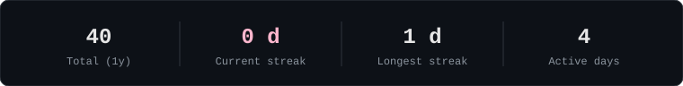

  
  &nbsp;
  

<h2 align="center">Tejasvi Pal</h2>

<b>ML Engineer · Co-founder @ Eve · SRE → Platform → ML</b>

  
  
  

### `./contributions.sh`

  
  

### `whoami`

I've spent ~8 years making systems work in production, first as an SRE, then on platform and ML platform teams, now as an ML engineer. These days I'm building **[Eve](https://evecare.ing)**, AI-powered eldercare alerts that help long-distance families keep track of a parent's reports, medicines and missed doses.

- 🧠 ML / LLM systems, evals, and getting models from notebook to production
- ⚙️ Platform & reliability: Kubernetes, CI/CD, observability
- 🎓 M.S. CS (AI specialization), Georgia Tech, Dec 2026
- 📍 Toronto, Canada

Graphics regenerate daily via GitHub Actions · <a href="./scripts">scripts</a>
